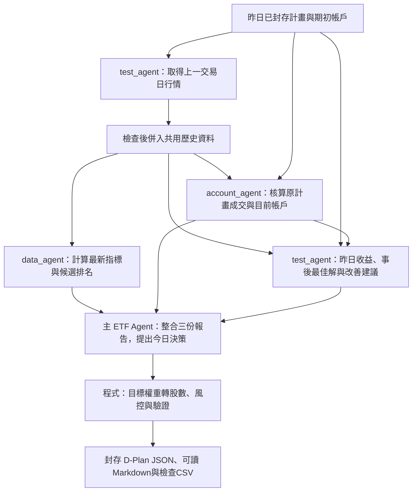
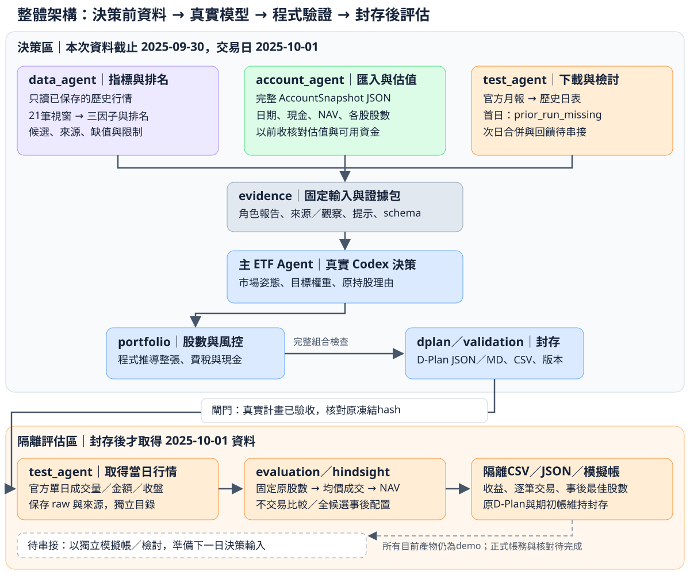

# 玉山 AI CUP：AI Agent 主動型 ETF MVP

將官方價量、因子排名與完整帳戶交給主 ETF Agent，由真實模型提出市場姿態及目標權重，再由程式計算股數、檢查風控、產生 D-Plan。封存後才取得交易日行情，在隔離區核算收益與事後最佳配置。

**目前可展示歷史流程，尚未達正式參賽提交條件。** 本次用截至 **2025-09-30** 的資料決策 **2025-10-01**，期初為 **10 億元人工 demo 帳戶**；`formal_eligible=false`、`submission_ready=false`。

[開會講解：每日設計](#開會講解每日設計) · [整體架構](#整體架構) · [執行流程](#執行流程) · [結果先看哪個檔案](#結果先看哪個檔案) · [專案檔案怎麼分](#專案檔案怎麼分) · [目前完成與待辦](#目前完成與待辦)

## 開會講解：每日設計

我們設計的是一個每天能根據歷史行情、前一天交易檢討與目前帳戶，決定今天要續抱、賣出或買進哪些股票的 ETF Agent。三個 sub_agent 分別提供資料、檢討與帳戶報告，主 ETF Agent 綜合判斷；股數與資金檢查由程式計算，最後輸出可驗證的 D-Plan。

**下圖是目標每日流程。** 角色資料夾、歷史決策與隔離評估已完成；每日歷史合併、跨日入帳與下一日回饋尚待串接。



可以照以下順序講解：

1. **先檢討昨天：** test_agent取得上一交易日的開收盤、成交量與金額，整理歷史，評估原計畫收益並搜尋受約束的事後最佳配置，提出改善建議。
2. **更新今天的依據：** data_agent只從已有歷史計算最新指標與排名；account_agent依原先採用的計畫核算現金與各股股數。成交用昨日均價，持股市值與NAV用昨日收盤。
3. **讓主 Agent 決策：** 主 ETF Agent讀三份固定報告，說明為何續抱、換股及各股配置多少；程式再換算股數、檢查完整組合與資金。
4. **讓人能查、程式能驗：** D-Plan JSON供結構與語意驗證，Markdown用表格說明今日決策，CSV讓人逐列核對資料、帳戶與委託。

時間界線是這個設計的核心：例如10/2決策只能使用截至10/1的資料，10/2行情要在10/2計畫封存後才能取得。事後最佳解只作檢討參考，帳戶承接原計畫的交易結果；保留每次輸入與產物版本，避免事後改寫決策。[每日設計細節與待串接介面](docs/daily_workflow.md)

目前可展示的例子是：**9月行情與9/30的10億元人工帳戶 → 真實模型決策10/1 → 15檔退出、10檔新買、10檔續抱 → 25筆委託、目標20檔 → 封存後才取得10/1行情驗證收益**。這證明歷史資料、完整持股、模型與D-Plan已打通；完整每日循環與正式帳務仍在後續工作範圍。

## 整體架構



實線是已完成的流程，虛線是待串接的下一日流程。[開啟完整架構圖](docs/assets/architecture.svg)可放大或供會議使用；圖中的程式位置見 [完整檔案索引](docs/source_map.md#核心流程模組)。

| 角色 | 現在負責什麼 | 相關說明 |
|---|---|---|
| **data_agent** | 只讀已保存歷史，計算價格視窗、三因子與排名，提供候選及資料問題。 | [因子](docs/factor_analysis.md)、[排名](docs/ranking.md) |
| **account_agent** | 讀完整帳戶，回報現金、NAV、每股股數與估值核對；可用資金目前是 demo 估計。 | [帳戶格式與回報](docs/account.md) |
| **test_agent** | 負責官方行情下載與整理；決策前回報檢討狀態，封存後在隔離區評估收益與事後配置。 | [行情取得](docs/history_data.md)、[隔離評估](docs/evaluation.md) |
| **主 ETF Agent** | 透過 Codex 讀固定證據包，提出市場姿態、目標權重，以及完整原持股的續抱／調整／退出理由。 | [真實模型決策](docs/decision_workflow.md#重新取得九月資料與真實決策) |

目前 sub_agents 是同一 Python 專案內的程式分工，主 ETF Agent 才呼叫投資決策模型。`portfolio`、`dplan`、`validation` 用程式計算與驗證最終股數；模型不直接更改帳戶。

決策資料與收盤後資料分開：10/1行情只在D-Plan封存後進入 `evaluation_quarantine`，隔離的模擬帳與檢討尚未自動接回下一日決策。

規劃的每日順序是 **test_agent 取得上一交易日行情、併入歷史並檢討 → data_agent 算最新指標／account_agent 核算原計畫帳戶 → 主 ETF Agent 決策並輸出 JSON＋Markdown**。成交與現金用昨日均價，持股市值與NAV用昨日收盤；事後最佳解作檢討參考。每日圖、報告內容與串接順序見 [每日流程](docs/daily_workflow.md)。

## 執行流程

以下是從資料到評估的順序。每一步連到輸入參數、完整命令與產物說明；沿用已完成資料時，可從對應階段開始。

| 步驟 | 做什麼／使用命令 | 輸入 → 輸出 | 操作文件 |
|---|---|---|---|
| **1. 取得截止日以前的資料** | `universe-check` → `calendar-download`、`history-universe` → `prices-check`、`history-window-check` | 150檔白名單、月份 → 官方月報、日表、日曆、21筆視窗報告 | [資料下載](docs/history_data.md)、[日曆與視窗](docs/calendar_windows.md) |
| **2. 計算因子與排名** | `history-features` → `history-rankings` | 視窗報告 → 三因子與綜合排名 | [因子操作](docs/factor_analysis.md#執行與重算)、[排名操作](docs/ranking.md#執行與重算) |
| **3. 準備並核對帳戶** | 匯入 AccountSnapshot；demo可用 `build-demo-account`，再用 `account-check` | 截止日帳戶、同日前收 → 完整持股估值、cash／NAV差額 | [帳戶輸入](docs/account.md#帳戶輸入格式)、[弱期初](docs/account.md#建立弱期初帳戶)、[核對指令](docs/account.md#執行方式) |
| **4. 凍結決策輸入** | `prepare-decision` | 排名、帳戶、截止日 → 三角色報告、證據包、提示、schema與hash | [角色與資料包](docs/decision_workflow.md#執行與產物) |
| **5. 呼叫模型並編譯計畫** | `decide-plan`；獨立編譯入口為 `compile-plan` | 凍結packet → 模型權重草稿 → 程式股數／風控 → D-Plan及驗證 | [模型呼叫](docs/decision_workflow.md#重新取得九月資料與真實決策)、[編譯與風控](docs/decision_workflow.md#股數風控與-d-plan-編譯) |
| **6. 封存後隔離評估** | `evaluate-plan` | 已驗收真實計畫 → 交易日官方量值 → 原計畫／不交易收益、事後配置與模擬帳 | [隔離評估、CSV與重播](docs/evaluation.md) |
| **7. 下一日決策** | 待串接 | 昨日行情併入歷史、原計畫模擬入帳／檢討 → 今日固定輸入 | [每日分工與串接](docs/daily_workflow.md)、[待辦](checklist.md) |

已有同日帳戶與官方日曆時，`refresh-decision` 可在一個 shared run 整合資料重抓、視窗／因子／排名與決策輸入準備；真實模型仍由 `decide-plan` 另行呼叫。[整合入口與參數](docs/decision_workflow.md#重新取得九月資料與真實決策)

`compile-plan` 是讀草稿的獨立編譯入口，不代表執行過真實模型；`evaluate-plan --market-manifest` 則重用明確指定的隔離行情，全程離線、不重新呼叫模型。[各入口完整責任](docs/source_map.md#核心流程模組)

## 結果先看哪個檔案

先開 shared run 根目錄的 **`workspace.json`**，依 `files` 找當次有效產物。下表是最常用的檔案；同名檔案依所屬階段分開。[所有輸出檔案、內容與使用方式](docs/artifacts.md)

| 想知道什麼 | 先看檔案 | 內容與讀法 |
|---|---|---|
| 所有資料／計畫放在哪裡 | `workspace.json`；本次另存 `run_summary.json` | [目錄與索引](docs/artifacts.md#先找到本次執行) |
| 行情完整嗎、為何排除某股 | `coverage.json`、`window_coverage.csv`、`data_issues.csv` | [行情與視窗檔案](docs/artifacts.md#行情日曆視窗與排名)、[四檔已知歷史不足](docs/history_availability_2025-09.md) |
| 指標與排名怎麼算 | `features.csv`、`rankings.csv`、各階段 `metadata.json` | [因子與排名檔案](docs/artifacts.md#行情日曆視窗與排名) |
| 當時有多少現金、各股幾股 | `account_positions.csv`、`account_summary.csv`、`account_report.json` | [帳戶／角色報告](docs/artifacts.md#決策前三份角色報告與證據包) |
| 模型為何買、賣或續抱 | `D-Plan_DEMO_<日期>.md`、`agent_decisions.csv`、`raw_response.json` | [可讀決策說明](docs/daily_workflow.md#d-plan-markdown-怎麼閱讀)、[計畫檢查表](docs/artifacts.md#計畫編譯股數驗證與封存) |
| 原計畫買賣哪些股、各幾股 | `orders.csv`、`D-Plan_DEMO_<日期>.json` | [股數、前收估算與驗證](docs/artifacts.md#計畫編譯股數驗證與封存) |
| 計畫驗證有沒有問題 | `validation_checks.csv`、`validation.json`、`manifest.json` | [驗證與版本](docs/artifacts.md#計畫編譯股數驗證與封存) |
| 交易後賺賠、每筆貢獻 | 隔離run的 `performance.csv`、`fills.csv`、`end_positions.csv` | [收益檔案](docs/artifacts.md#隔離評估當日行情收益與事後配置) |
| 事後最佳選股與股數 | 隔離run的 `hindsight_orders.csv`、`hindsight_positions.csv`、`hindsight_optimization.json` | [最佳配置與求解狀態](docs/evaluation.md#最佳的範圍) |

JSON保留精確值、合約與來源，CSV方便Excel檢查，D-Plan Markdown用表格呈現同份計畫與原理由。空欄表示未知；股、張、元、千元與百分數要依各檔案欄名讀取。[單位與同名檔案注意事項](docs/artifacts.md#共通閱讀原則)

`data/cache/` 被Git忽略，新clone需依流程重建；GitHub導航連到說明文件，快取檔案用本機路徑與workspace索引查看。

## 專案檔案怎麼分

```text
src/etf_agent/
├─ cli.py                          所有CLI入口
├─ sub_agents/
│  ├─ test_agent/                  行情下載、官方adapter、收益與事後最佳化
│  ├─ data_agent/                  價格視窗、因子與排名（只讀歷史）
│  └─ account_agent/               帳戶匯入、估值、現金與完整股數回報
├─ decision/                       主ETF模型、配置／風控、D-Plan JSON／MD與驗證
│  └─ providers/                   投資模型介面與Codex呼叫
├─ pipeline.py、evidence.py         組合資料、角色報告與固定輸入
├─ contracts.py、universe.py        共用合約與白名單
├─ prices.py、coverage.py           共用行情讀取與資料檢查
├─ calendar.py、providers/http.py   共用交易日與HTTP傳輸
└─ reports.py、paths.py             共用CSV輸出與專案路徑
```

[完整程式檔案索引](docs/source_map.md)逐檔列出內容、責任、使用入口與對應文件，包含 `reports.py`、各adapter、測試、fixtures與官方来源。

| 目錄／檔案 | 放什麼、怎麼用 | 說明 |
|---|---|---|
| `src/etf_agent/` | 可重用核心程式；一般透過CLI組合執行 | [每個模組的責任與呼叫者](docs/source_map.md#核心流程模組) |
| `config/ranking.json` | 三因子啟用與固定40／25／35權重 | [權重及設定](docs/ranking.md#設定與模組責任) |
| `prompts/decision.md` | 每日投資模型提示，與開發合作規則分開 | [草稿與提示](docs/decision_workflow.md#主-etf-agent-的權重草稿) |
| `data/universe.csv`、`data/universe.manifest.json` | F05衍生白名單與官方來源／hash | [白名單使用](docs/quickstart.md#白名單核對) |
| `specs/official/` | F01～F09原始官方文件，不修改來源內容 | [逐份官方檔案用途](docs/source_map.md#九份官方來源) |
| `specs/internal/`、`contracts.py` | 內部模型草稿schema與Python資料合約 | [資料格式](docs/data_contracts.md) |
| `tests/`、`tests/fixtures/` | 關鍵行為測試、人工帳戶及假行情示例 | [逐項測試與fixture日期](docs/source_map.md#測試索引) |
| `docs/` | 架構、資料、因子、帳戶、決策及評估操作說明 | [說明文件索引](docs/source_map.md#先找到對應文件) |
| `data/cache/` | 本機下載資料、各run的CSV／JSON、模型／計畫封存 | [每種輸出檔案](docs/artifacts.md) |
| `pyproject.toml`、`.venv/` | 專案依賴／CLI設定、本機Python環境 | [環境設定](docs/quickstart.md#環境設定) |
| `design1001.md`、`checklist.md`、`development_notes.md`、`AGENTS.md` | 設計草案、完成證據、批次紀錄、合作規則 | [根目錄文件用途](docs/source_map.md#根目錄檔案) |

## 環境與指令

需要 **Python 3.11以上**。從專案根目錄開啟PowerShell；已有 `.venv` 可直接設定 `PYTHONPATH` 並查看命令：

```powershell
python -m venv .venv
.\.venv\Scripts\python.exe -m pip install -e .
$env:PYTHONPATH = (Resolve-Path -LiteralPath 'src').Path
.\.venv\Scripts\python.exe -B -m etf_agent.cli --help
.\.venv\Scripts\python.exe -B -m etf_agent.cli contracts-demo
```

`contracts-demo` 僅驗格式，使用2026-10-14人工帳／假價，與本次9/30歷史帳分開。收益最佳化另需評估依賴：`pip install -e ".[evaluation]"`；`decide-plan` 則需既有Codex CLI與本機登入，會呼叫真實模型。[完整環境與個別命令](docs/quickstart.md)

下載、真實模型與離線重播是不同入口；各步驟的完整指令已連在 [執行流程](#執行流程)，所有命令都可用 `--help` 查參數。閱讀檔案與文件本身不會觸發下載或模型。

## 目前完成與待辦

| 已完成的歷史演示 | 範圍 |
|---|---|
| 官方行情與分析 | F05共150檔；九月取得147檔行情，截至9/30有146檔完整因子／排名 |
| 帳戶與三角色資料 | 25檔弱期初、NAV10億元；完整股數／cash估值與六份角色CSV |
| 真實模型與D-Plan | 自主15退出／10新買／10續抱，25委託、目標20檔，本地結構／語意通過 |
| 角色整理與決策說明 | 三個agent獨立資料夾，下載／指標／帳戶責任分離；新計畫自動生成Markdown表格 |
| 封存後隔離評估 | 原計畫、不交易與146候選事後配置比較，8份CSV及獨立simulated帳戶 |

目前結果與數值分別見 [決策驗收](docs/decision_workflow.md#第-24-批弱期初重新決策實跑)、[收益驗收](docs/evaluation.md#第25批實跑)。各批開發歷史集中於 [development_notes.md](development_notes.md)。

待完成包括：每日增量資料整合、前日檢討／期末帳戶接入下一日、正式候選資格／流動性、公司行動及公開時間核實、SQLite帳務／重複入帳／主辦方結算核對、Claude provider與正式提交流程。以 [checklist.md](checklist.md) 的完成證據為準；設計草案中的介面不代表已實作。

[GitHub倉庫](https://github.com/ismesid/yushan-etf-agent-MVP)為私有、主要分支 `main`。官方附件保留作參賽參考，本專案目前未指定開源授權。
