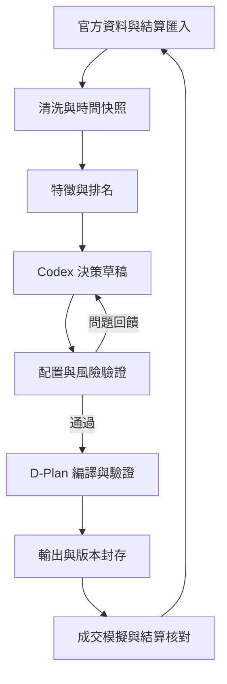

# 玉山 AI CUP：AI Agent 主動型 ETF MVP 架構設計

版本：v0.3｜整理日期：2026-10-11｜實作時間：從開始工作起 8 小時，包含討論與驗收

檔名依需求保留為 `design1001.md`。本檔案是可交給本地 Codex 實作的規格；下列程式路徑、指令與測試是**待建立的介面**，不是已完成的軟體。逐項工作與時間分配見同資料夾的 `checklist.md`。

本版合作規則集中於一併提供的 `AGENTS.md`：先解釋本批工作的目的、輸入輸出、修改範圍與執行計畫，確認使用者理解並明確同意後才實作。完成本批與驗證後停下，討論下一批。§20 提供新版初始 prompt；不得沿用舊版「直接開工」的要求。將三份 Markdown 放在專案根目錄，九份來源依 §2.1 放在 `specs/official/`。

## 1. 第一版要做到什麼

建立一個 Python 專案，能讀取競賽限定的 150 檔股票、官方歷史價量與已確認的庫存，計算多因子分數，交給本地 Codex 做市場研判與選股，經程式配置、風控、官方股數公式與驗證後，輸出一份 D-Plan 4.2 和可供開會檢查的報告。收盤後用成交資料更新模擬帳，再和主辦方結算核對。

**8 小時驗收重點是完整流程與可追溯性；不宣稱已找到高報酬策略。** 第一版採多因子排序，不在這 8 小時內訓練預測模型。模型真的參與選股、風險姿態與持股理由；股數、費用、庫存與合規由程式計算。

| 項目 | P0：8 小時內 | P1：會議後 |
|---|---|---|
| 資料 | 150 檔白名單、上市／上櫃價量、交易日曆、大盤、庫存 | 法人、月營收、財報、事件、海外行情 |
| 特徵 | 20 日動能、20 日均線偏離、20 日低波動；流動性作篩選 | 60 日動能、法人流量、營收年增、估值與品質 |
| 演算法 | 橫斷面百分位排名＋固定權重；受約束配置 | 時序驗證後比較 LightGBM、線性模型、組合最佳化 |
| Agent | 本地 Codex CLI／互動讀檔；固定 JSON 合約 | Claude API 真實呼叫、工具迴圈、更多資料源 |
| 執行 | CLI、CSV／JSON、SQLite、Markdown 報告 | 排程、通知、圖形介面、自動下載後台資料 |
| 競賽輸出 | D-Plan 4.2、結構＋本地語意驗證、版本存檔 | 接官方驗證器、真實提交與正式績效追蹤 |

若官方資料抓取卡住，改用**已儲存的真實官方資料**跑會議演示；再不行才用明確標記的測試資料。測試資料／假庫存的產物只可進 `demo/`，不得進正式提交目錄。不要因為資料未接好就把未完成的流程當成正式可用。

## 2. 來源、官方限制與未確認項目

### 2.1 上傳來源索引

以 `F01`～`F09` 標記九份來源，放在專案根目錄下的 `specs/official/`，使用下列標準檔名。只調整檔名與位置，保留官方內容；來源內容有新版本時另行保存並記錄版本，不直接覆寫。

| ID | 專案內標準路徑 | 用途 |
|---|---|---|
| F01 | `specs/official/01_etf_strategy_template_v1.docx` | ETF 名稱、主題、理念繳交格式 |
| F02 | `specs/official/02_etf_strategy_example_v1.pdf` | 名稱／字數／繳交期間、主題一致性與因子例子 |
| F03 | `specs/official/03_active_etf_list_v1.pdf` | 2026-09-11 主動型 ETF 列表，作參考 |
| F04 | `specs/official/04_D-Plan.schema_v4.2.json` | D-Plan 正式結構、欄位數量、部分語意描述 |
| F05 | `specs/official/05_stock_universe_150_v1.pdf` | 唯一可交易白名單：100 檔上市＋50 檔上櫃 |
| F06 | `specs/official/06_google_token_credit_guide_v1.pdf` | 課程完成證明、Credit 取得程式與期限 |
| F07 | `specs/official/07_D-Plan_guide_v4.2.md` | 證據鏈、股數換算、費用、庫存與版本規則 |
| F08 | `specs/official/08_D-Plan_positive_example_v4.2.json` | 正例：結構與引用鏈示範；不是完整帳戶／真實行情 |
| F09 | `specs/official/09_D-Plan_negative_example_v4.2.json` | 反例：斷引用、股數不一致、姿態不一致 |

F03 的 ETF 是參考物件，**不能當成 F05 可交易股票**。F08／F09 的未來日期、示意網址、行情、模型名稱與 TEAM 編號，都不能照抄成隊伍真實資料。

### 2.2 確認的競賽限制

| 限制 | 系統必須執行 | 依據 |
|---|---|---|
| 標的 | 買進與持有隻限 F05 的 150 檔；ticker 為字串 | F05、F07 |
| 持股數 | 調整後持股 20～30 檔；以實際正股數計，不以選股清單計 | F07 |
| 單股權重 | 2330 ≤25%；其他股票 ≤10%；是佔**總 NAV**的比例 | F04、F07 |
| 現金 | 0～25%；需估算成交後費用與價格偏移 | F04、F07 |
| 交易 | 現股、不放空、不當沖；股數為正的 1,000 倍數 | F04、F07 |
| 股數 | 必須依 target_weight、前日 NAV、前日官方收盤與實際庫存換算 | F07 |
| 覆蓋 | 每檔昨日持股在 decisions／no_trade_decisions 擇一出現；不得重複 | F07 |
| 證據 | order→decision→inference→observation→source 引用完整 | F04、F07 |
| 姿態 | increase／reduce／hold 與預估委託淨流向一致；現金區間也要一致 | F04、F07 |
| 資金調度 | funding_for 只連同日 BUY／ADD；移除全部調度賣出後確實有缺口 | F04、F07 |
| 庫存 | 賣出不得超過主辦方結算股數，超賣整份拒收 | F07 |
| 策略一致性 | 每日交易能對回事先提交的 ETF 主題、理念與因子 | F02、F07 |
| ETF 文案 | 名稱 20 字內、中文／英文、開頭「主動」；主題 50 字內；理念 100～300 字 | F02 |
| 公開說明書 | 上傳檔案寫的繳交期間為 2026-10-21～10-26 | F02、F07 |
| 時間／檔名 | Asia/Taipei、`+08:00`；`D-Plan_<team_id>_<trade_date>.json` | F04、F07 |

### 2.3 規格差異及正式上線阻擋條件

1. **初始資金不是直接抄範例 NAV。** 清大轉載的競賽公告寫 10 億元（W06）。F08 的 102,000,000 元只是示例計算。設計暫以 `demo_initial_cash=1000000000` 演示；正式跑必須匯入隊伍實際期初配置與結算 NAV，不可假設全現金建倉就是官方流程。
2. **收件截止時刻、T 日資訊鎖、可否使用試撮資料：未從這九份附件取得完整規則。** 官網本次讀取回傳 403。將截止與合法資訊區間設為必填正式配置，不能自行認定 08:30、08:45 或某個資料來源合法。演示可自訂 cutoff，但報告須註明不是官方截止。
3. **庫存描述前後不同。** F07 前段說自行記帳、系統不提供；後段明確要求看參賽者後台庫存。採「自行記帳＋每日匯入後台結算作權威」；無法核對就不能宣稱正式可提交。
4. **拒收／警告描述不同。** F09 將股數與姿態不一致列警告；F04 的 C12 說姿態／現金區間不一致拒收，C2 要求委託精確吻合。自己的 validator 對上述專案一律 BLOCK，不以反例的警告文字當成可放行依據。
5. **費用四捨五入、現金比例分母、除權息／分割／併購、當日無成交時處理、結算權重取價、正式初始持股方式：尚缺完整辦法／官方驗證器確認。** 在規則登記表設 `UNCONFIRMED`。會議演示使用明列假設；正式提交模式碰到未確認的必要項即停止。不要編造官方結算演算法。
6. **AI 認定與審查。** 附件要求模型、程式版本、決策過程可查。當天真實呼叫 Codex 並保留選股／姿態／理由與工具紀錄；只有請 Codex 寫程式、每天純規則執行，不等於已證明符合主辦方 AI 決策資格。正式上線前核對完整 AI 參與／重跑要求。
7. **Credit。** F06 的 9 與 200 是 Skills Boost 學習積分；完成課程並提交證明後才發 Token Credit 序號。這份 PDF 沒寫美元額度，不把 200 積分視為每天 200 美元，也不從記憶推定模型抵免額。

正式配置的 `official_rules_confirmed=false` 時，可產出會議稿與內部驗證報告，`submission_ready` 必須是 false。

## 3. 策略第一版：跨產業動能與風險控制

暫用因子型主題，讓 8 小時 MVP 和宣告保持一致，不必先辨識一整條 AI／半導體供應鏈。

- 暫名：**主動臺股動能風險優選**。
- 暫定主題：以股價動能、趨勢與波動風險，選取臺灣上市櫃股票並主動調整配置。
- 理念內容：說明價格因子、流動性、單股限制、現金及產業分散，並說清楚 Agent 如何參與。正式文案另按 F01 製作與字數檢查；這次兩份檔案不代表已提交公開說明書。

P0 不宣告已經用 ROE／EPS／新聞選股。之後啟用基本面因子，需要更新內部策略版本，確認與已提交理念是否相容。

所有權重、門檻、現金目標、波動下限均為**MVP 設計參數**，不是官方要求或經回測證明的最佳值。

## 4. 架構與各模組責任



| 模組 | 輸入 | 輸出 | 實作規則 |
|---|---|---|---|
| universe | F05 | `universe.csv` | 恰 150 檔、100 TWSE／50 TPEX；人工逐頁對照一次 |
| providers | trade_date、查詢日期 | 原始回應＋metadata | timeout、限速、快取、重試；不用模型產生行情 |
| clean | 原始回應 | 標準價量、品質報告 | 單位、空值、日期、異常、重複檢查 |
| features | point-in-time 價量 | factors、rankings | 全部 Python 計算、可重現 |
| evidence | 使用的原始與特徵 | sources、observations | 每個數字可對回原始資料及公式 |
| agent | 凍結 evidence、排名、帳戶、規則 | `AgentDraft` | Codex／Claude 共用內部合約 |
| allocator | Agent 選股、cash、conviction | 全組合權重與預估股數 | 現金、檔數、上限、續抱及換股限制 |
| dplan | 已確認方案、證據、真實 metadata | 官方 D-Plan | 股數機械推導；只輸出官方允許欄位 |
| validation | D-Plan＋帳戶＋價量＋規則 | BLOCK／WARN／PASS | 不讓 LLM 的 risk_check 字串替代檢查 |
| ledger | orders＋官方當日量值／後台結算 | 模擬／已核對庫存 | 未成交、不超賣、費用、重複入帳保護 |
| versions | code／config／prompt／data／outputs | manifest＋不可改封存 | 同一輸入可重播；新草稿新 run_id |

先用單一 Python 流程、普通函式、SQLite；不需要 LangChain、向量資料庫、Docker 或多 Agent 框架才能演示。

### 4.1 必須具備的擴充邊界

目前模組切分已可作起點；再固定共用資料合約與可替換介面，避免後續功能牽動整個專案。介面需在第一次實作前討論，不必每個模組都建立 class。

| 邊界 | P0 最小設計 | 之後增加功能的方式 |
|---|---|---|
| 資料來源 | TWSE／TPEx／CSV adapter 輸出同一價量格式與 provenance | 接法人、營收時增加 adapter／新資料型別，不把 API 欄位傳遍下游 |
| 特徵 | 個別因子函式＋簡單名稱對照表；輸出數值、缺失原因與來源 | 註冊新因子，補資料與測試；排名程式依設定讀啟用因子與權重 |
| 模型 | 同一 AgentProvider 與 AgentDraft 合約 | 增加 Claude adapter，沿用配置、風控、編譯與帳務 |
| 配置 | 統一 PortfolioProposal：完整目標權重、選股集合、現金與理由引用 | 等權、分數／波動或日後最佳化各輸出同一合約 |
| 規則 | 官方規則版本與自訂風控設定分開；所有提案經同一驗證 | 更新門檻不修改帳務；官方規則變版要保留舊版本及差異 |
| 計算與儲存 | 因子、股數、費用用可獨立檢查的函式；I/O 在 adapter／repository 層 | 用 fixture 重跑；換儲存方式不改交易數學 |
| 使用入口 | CLI 只編排上述呼叫，核心函式不讀 CLI 參數或寫死本機路徑 | UI／排程呼叫同一套核心流程 |

共用資料型別最少涵蓋 `MarketSnapshot`、`AccountSnapshot`、`FeatureTable`、`AgentDraft`、`PortfolioProposal`、`ValidationReport`。第一版可用 dataclass／Pydantic 與少量 Protocol；選一套清楚的做法，不同模組不要各自重複定義同名欄位。欄位、單位、時間、空值政策及版本需可查。

建議依賴方向：CLI／pipeline 組合各模組；各模組依賴共用型別。共用型別不匯入 CLI、HTTP client 或模型 SDK。LLM adapter 不自行呼叫 ledger；D-Plan compiler 不抓行情；因子計算不讀環境金鑰。

擴充驗收案例：加入法人因子可沿用 orders／ledger；換 Claude 可沿用風控；加入 UI 可沿用 pipeline。新增市場／幣別會牽涉新的交易日曆、規則與帳務，不能承諾只換 URL 即可。每個新增抽象要對應具體需求，P0 不建自動插件發現、微服務或多層繼承。

### 4.2 先以最小資料跑通，再補真實外部資料

先用固定 fixture／已封存官方快取，確認每個模組接得上；再替換正式來源。真實 Codex 決策仍是 MVP 驗收必要項，fixture 不代替它。第一次批次可只建立約定的型別／目錄與一個小資料例子，使用者看懂後再接 provider。

討論與驗收包含在 8 小時內：每批以一個能展示結果的小任務為準，約 10～30 分鐘；較大的階段可拆兩批。壓縮 P1 功能，保留關鍵交易與帳務測試，不以省時間為理由省略事前共識。

## 5. 資料來源與取得方式

### 5.1 必接來源

| 資料 | 首選來源／入口 | 最少欄位 | 用途及限制 |
|---|---|---|---|
| 150 檔 | F05 | ticker、name、market | 以這份名單為準，不用市值前 150 取代 |
| 上市最新日價量 | `https://openapi.twse.com.tw/v1/exchangeReport/STOCK_DAY_ALL` | 日期、代碼、OHLC、成交股數／金額 | F08 提供網址；正式股數計算使用未調整官方收盤 |
| 上市歷史 | TWSE 個股日成交資訊／月報 CSV（W02）；歷史每日全市場報表可作批次方案 | 同上 | 需要至少 21 個連續有效交易日，建議下載 90 個日曆日 |
| 上櫃最新／歷史 | TPEx 每日收盤行情（W03），其 OpenAPI／CSV | 同上 | 不能只抓 TWSE 而漏掉 50 檔上櫃；實測欄位與單位 |
| 大盤 | TWSE 每日市場成交資訊（W01）；必要時 TPEx 指數 | 日期、TAIEX 收盤、金額 | 市場研判與市場級 observation |
| 產業分類 | TWSE／TPEx 官方公司基本資料或可驗證的官方分類下載 | ticker、industry | 自訂產業分散需要；不是靠股票名稱猜分類 |
| 交易日曆 | TWSE／TPEx 官方休市日與日期列表 | 交易日、休市日 | T-1 是前一交易日，不是日曆前一天 |
| 帳戶 | 主辦方後台結算明細／匯出；MVP 手動 CSV／JSON 匯入 | 結算日、ticker、shares、cash、NAV | 每天同步，儲存原始結算證據，禁止估算冒充官方 |

TPEx OpenAPI 的候選價量端點是 `https://www.tpex.org.tw/openapi/v1/tpex_mainboard_daily_close_quotes`。本次官方端點讀取受阻，**路徑、欄位、可查歷史方式須在隊伍本地實測**，不要視為已通過整合。退路用同機構官方 CSV，仍需驗日期與單位。

不能假設 latest OpenAPI 加 `?date=` 就提供歷史。每次比較回應內資料日期與請求日期；不一致則不可作該日期歷史。抓到 HTML、空資料或 403 都記失敗，不產生假數字。

### 5.2 P1 可接資料及開關

| 資料 | 來源／authority | 匯入前要解決 |
|---|---|---|
| 法人買賣超 | TWSE／TPEx 官方法人報表；各自 `twse`／`tpex` | 兩市場股／張一致、外資是否含自營及不可重複加總 |
| 月營收 | MOPS／公司申報（W04）；`mops` | 資料期與真實公告時間分開；用 cutoff 前已公告版本 |
| EPS、ROE、PE／PB | MOPS／官方估值表 | 公告延遲、金融與非金融可比性、虧損 PE 不能排序成便宜 |
| 重大訊息 | MOPS | 取原公告與發布時間；有足夠事實才準 veto／減碼 |
| 新聞／海外 | 合法媒體／行情供應商；`media`／`vendor` | 用量／授權、釋出時區、第三方存檔、未來資訊隔離 |
| 主動 ETF 持股 | F03 對應投信資料；`fininst` | 僅研究參考；不是抄持股就能取得有效 AI 決策證據 |

不要讓本地 Codex 自由上網找沒有封存的價格後直接填入決策。P0 先從 Python 凍結的資料包判斷；日後工具搜尋必須經 provider 儲存證據、重新凍結，再重跑決策。

### 5.3 取得、快取與失敗政策

- 每個 provider：10 秒 timeout，最多 2 次重試，回應失敗不得長時間拖住流程；低併發（1～2）、遵守站方限制與實際 Retry-After。這是客戶端預設，不代表站方允許的頻率。
- 原始回應以 URL／query／日期／抓取時刻／SHA256 存檔；HTML 錯誤頁不進行情表。
- 歷史資料優先「日期×全市場」批次或官方下載，避免 150 檔×多個月逐檔連續敲 API。
- 歷史補抓在啟動前完成；每日只增補最新已完成交易日。
- 抓取時間 `fetched_at` 真實記錄，不能改成歷史日期。歷史演示與即時正式決策要分開。
- 擇一可用路徑：官方 API → 官方 CSV → 已封存官方快取 → 明示 demo fixtures。不得繞過封鎖或默默換成未核實 vendor 價格。

## 6. 資料格式、清洗與時間防洩漏

### 6.1 內部資料合約

`universe.csv`：

```text
ticker,name,market,industry,theme_tag
2330,臺積電,TWSE,半導體,unclassified
```

`industry` 取官方公司基本資料，保存來源；沒有則用 `UNKNOWN`，不是叫模型猜。所有 UNKNOWN 視為同一產業桶，不能用未知分類繞過分散限制。若產業資料暫時全部缺失，40% 產業上限會使正常配置不可行：先補官方分類；只做流程演示時，可明確設定 `sector_check_enabled=false` 並在報告標示未實作分散，不能把該 run 說成通過了產業風控。正式策略若承諾產業分散，未補分類不得關閉後放行。

`prices.csv`（長表，所有價格用元，數量用股，金額用新臺幣元）：

```text
trade_date,ticker,market,open,high,low,close_raw,volume_shares,amount_twd,source_key,price_valid,tradable
```

內部另存 `return_close`（因子用）、`adjustment_status`、`known_at`、`fetched_at`、`raw_sha256`、資料版本。用原價計算因子的 P0 必須標示；如果 20 日區間有未處理除權息／分割，該股不新建倉，不把斷點當作價格訊號。既有持股須用已核實的公司行動與結算狀態管理，不能刪掉。

`account_snapshot.json`（內部格式，不放進官方 D-Plan）：

```json
{
  "as_of_trade_date": "2026-05-04",
  "status": "demo",
  "cash_twd": "1000000000.00",
  "nav_twd": "1000000000.00",
  "positions": [],
  "origin": "synthetic_initial_account",
  "reconciled": false
}
```

此例只是全現金測試帳，不是可提交的初始帳。真實 snapshot 的 positions 至少含 `ticker`、`shares`（股數整數）；`status=official_confirmed` 及 `reconciled=true` 必須對得回實際後台證據。

### 6.2 清洗順序

1. ticker 一律保留四位字串、market 分開；白名單外列不進候選池。
2. ROC 日期加 1911；統一 ISO 日期，資料日與抓取時刻分開。
3. 清除千分位逗號、空白；`--`、空字串等轉 null，不轉 0。
4. 由 provider 對照單位後把張→股、千元→元。單位不明直接失敗，成交均價須以元／股得元。
5. 日期×股票唯一；相同重複可去重，衝突値保留原始證據並 BLOCK，不能任選最新。
6. close／OHLC 合理且價格 >0；有 OHLC 時 high≥low、open／close 在範圍內。缺欄位不得假造。
7. 量值不可負；有量無金額、日期錯配、金額／股數所得均價明顯與原始範圍不符，列資料錯誤。
8. 建完整交易日索引；不把週末、休市或停牌日填成成交。20 日區間按市場交易日對齊。
9. `tradable=false`（停牌、無有效收盤等）不新買；現有庫存照樣計入覆蓋與風控。
10. 檢查公司行動，不使用今天回填的調整價假裝歷史已知。P0 無調整資料就採前述排除政策。

### 6.3 空值及資訊區間

- P0 三個核心因子需同一股票有完整 21 個有效且連續市場交易日的價格；不滿足者不新選。已有持股即使因子缺失，也要列觀察、理由與處理狀態，不能從帳戶消失。
- 低波動因子為 0 波動的情況需檢查是否停牌／錯誤；不獎勵填值形成的假穩定。
- 法人／營收等 P1 缺資料不填成看多值。採整個 run 的固定 `factor_profile`；不能逐股票改權重，使分數不具可比性。
- 今日決策 T 價量只能用 ≤前一交易日 T-1 的已完成資料；T 日均價是**收盤結算資料**，不能放進 T 盤前特徵。
- 另要 `known_at≤snapshot_cutoff`：營收屬於 9 月，不表示 9 月底已知；採 cutoff 前實際公告／版本。
- 正式模式驗 source 內容時間、釋出時間與抓取時刻均符合已確認規則。對 `content_as_of` 只有日期的來源，存官方交易日收盤時間與可驗證更新資訊，不能把猜測時間寫成確切發布時刻。
- 同一市場資料日必須一致。大盤用 T-1；若美股／夜盤 P1 接入，換算臺北時區及該交易時段，不套用臺股日期。

輸出 `data_quality.json`：每市場日期、白名單覆蓋率、有效股數、缺失／單位／公司行動清單、`demo_mode`、`blockers`。可選股不足 20 或缺帳戶 NAV／可賣庫存，不進提交。

## 7. 特徵定義：每個因子代表什麼與如何使用

記號：t 為 T-1，P 為因子用收盤序列，C 為未調整官方收盤；r_d=P_d/P_(d-1)-1。所有收益率以小數存（0.03=3%），`*_pct` 若用百分數則在名稱與檔案註明，不混用。

### 7.1 P0 核心與輔助特徵

| feature | 精確公式／需要資料 | 意義 | 運用 |
|---|---|---|---|
| `mom20` | `P_t/P_(t-20)-1`，21 筆價格 | 過去 20 交易日表現 | 分數正向，動能較高優先 |
| `trend20` | `P_t/mean(P_(t-19:t))-1` | 價格相對短期均線的位置 | 分數正向；不能說高於均線保證上漲 |
| `vol20` | `std(r_(t-19:t), ddof=1)*sqrt(252)`，20 個報酬 | 近 20 日年化波動估計 | 分數反向；配置用風險尺度，不是未來損失機率 |
| `adv20_twd` | `mean(amount_(t-19:t))` | 平均每日成交金額 | eligibility／流動性驗證，不算分；預設 ≥5,000 萬元 |
| `lot_nav_pct` | `1000*C_t/NAV_(T-1)` | 一張股佔帳戶比例 | 防止高單價股票在整張化後消失或過重 |
| `breadth20` | 候選有效股票中 `P_t>SMA20` 的比例 | 市場內部廣度 | 市場級 observation；不足覆蓋時不宣稱全市場廣度 |
| `taiex_mom20`／`taiex_trend20` | 同價格公式套 TAIEX | 市場趨勢背景 | market_view 的資料依據；不使用單股分數平均冒充大盤 |
| `current_weight` | `current_shares*C_t/NAV_(T-1)` | 現有庫存曝險 | 再平衡、超限檢查與續抱理由 |
| `weight_gap` | `proposed_weight-current_weight` | 新舊配置差 | 檢查無交易帶，不等於委託股數 |

`mom20` 和 `trend20` 是相關的價格趨勢訊號；三個欄位實際主要涵蓋**趨勢與波動兩種經濟面向**，不能宣稱已整合基本面／籌碼等獨立因子。P0 的目的為跑通流程與建立 baseline。

### 7.2 P1 因子（先留欄位、關閉）

| feature | 公式／方向 | 含義與啟用條件 |
|---|---|---|
| `mom60` | `P_t/P_(t-60)-1`，正向 | 中期動能；需 61 個有效交易日及公司行動處理 |
| `inst_flow5` | `sum(5日法人淨買股數)/sum(5日成交股數)`，正向 | 相對交易量的法人需求；分母為 0 無效；不能混成元／股 |
| `revenue_yoy` | `本期已公告月營收/去年同期營收-1`，正向 | 營收成長；去年為 0 無效，需 point-in-time 公告 |
| `pe`／`pb` | 合法正值、同產業內分位 | 估值；負 EPS／不同產業不能直接全市場低 PE 優先 |
| `roe`／`eps_growth` | 官方已公告財報再推導 | 品質／成長；虧損跨零期不能直接百分比增長排序 |
| `event_flags` | 從真實公告抽取事件類別與 O 引用 | Agent 的可解釋風險否決；缺資訊不能生成事件 |

P1 延伸 profile 示例：mom20=.25、mom60=.10、trend20=.15、低波動=.25、法人=.10、營收=.15，合計 1。只有資料及時間驗證完整後啟用；先回測與檢查相關性，再決定最終權重。

## 8. 多因子演算法：先排名，再讓 Agent 決策

### 8.1 演算法與精確計算

不用現成金融預測模型作 P0。採橫斷面多因子排名（cross-sectional rank）＋加權分數：

1. 在同一天的有效候選股票中計算原始特徵。
2. 每因子用 `rank(method='average')`；N>1 時 `pct_rank=(rank-1)/(N-1)`。相同值取平均名次；若全部相同則每股為 0.5。
3. 正向因子直接用分位；低波動得分用 `1-pct_rank(vol20)`。不用符號相反後又再反向。
4. P0：`score=0.40*rank_mom20+0.25*rank_trend20+0.35*rank_lowvol20`。
5. 分數降序，平手以 ticker 升序固定排序。儲存 eligibility 與每因子貢獻，不只存最後名次。

百分位排名對極端值較穩健；P0 不再加一層會改變結果的 winsorization。極端報酬先檢查公司行動或資料錯誤。這些權重不是訓練結果，也不代表 65% 趨勢曝險可以保證賺錢。

### 8.2 baseline 與真正的 AI 參與

- baseline：依 score 取前 25，現金 10%，固定配置；只用來比較／測試。
- Agent 決策池：前 30 名合格候選＋所有現有持股＋最多 5 檔分散補充候選；合併後最多 65 檔，先建來源預算。
- Agent 從池內選出目標 25 檔，可在 20～30 範圍內提案；為每檔設定 conviction=.8／1／1.2、選入／續抱／退出理由及 observation 引用；只能用包內資料。
- Agent 根據大盤／廣度判定 regime、stance、cash_target，及反方證據；不能只替固定結果潤飾文字。
- 若整張／風控修改選股、現金或配置含義，回饋給同一 Agent 確認修訂，保留前後 draft；不默默覆寫模型意思。
- Agent 可與 baseline 相同，不能為了展示 AI 而強迫換股。保留真實輸入、輸出與選擇痕跡，讓人知道本次是否有實質選擇。
- `provider=fixture` 僅測試內部合約與其他模組，所有輸出標記 demo；不填假的 provider、model_version 或 token 數。

### 8.3 市場姿態與現金

給模型的參考規則（是設計建議，不是市場定律）：

| 技術訊號建議 | cash_target 參考 | 可宣告區間 |
|---|---|---|
| TAIEX>MA20、mom20>0、breadth≥0.6 | risk_on：8% | 約 5～12% |
| TAIEX<MA20、mom20<0、breadth≤0.4 | risk_off：18% | 約 15～22% |
| 其他／相反訊號混合 | neutral：10% | 約 7～15% |

Agent 可提出不同結論但要引用支援與反方訊號。硬限制只允許 0～25% 現金；我們的正常設計區間 5～22% 作緩衝。姿態與實際淨買賣不一定同向，例如已經低倉位時 risk_off 仍可 hold。

`net_exposure_intent` 最終要符合委託。編譯器計算淨流向供 Agent 看到；如與先前意圖相反，需修訂提案或研判，不只是事後把 reduce 改成 increase 來掩飾。

### 8.4 P1 訓練模型路線

若改用 LightGBM／線性迴歸，需先定標籤（例如未來 5 日報酬）、時間序列切分，訓練只能使用該日期前已公佈資料，purge／gap 至少涵蓋標籤重疊期，扣競賽費用並按實際交易日模擬。不要隨機 train/test split 股票日資料，也不在同一競賽區間反覆調參後宣稱驗證有效。

## 9. 配置演算法與風控

### 9.1 全組合配置，不能只看要買的股票

輸入：Agent 選股集合、conviction、cash_target、已確認 current holdings、N（前日 NAV）、C（前日官方未調整收盤）。輸出 full targets，包含未異動的既有持股與預定退出的 0 權重。

基礎偏好：

```text
b_i = (0.5 + score_i) * conviction_i / max(vol20_i, 0.15)
股票預算 B = 1 - cash_target
初始權重 w_i = B * b_i / sum(b)
```

0.15 是年化波動下限，避免極低波動被配超重。若因子缺失而必須凍結持股，先按實際股數算其權重，扣出剩餘預算；不可用假 vol20 給它配置。

用 capped proportional allocation（水位分配）反覆封頂與重分配剩餘預算：一般股內部 cap=8%，2330=20%；官方硬限仍為 10%／25%。產業桶 cap=40% 是自訂配置限制，不是官方值。對碰到產業上限的桶也一起封頂，再對其他桶分配。迭代上限 100 次、金額／權重容差明定，無可行解就回 Agent 擴大池／變更選股，不能突破官方限制。

若實作水位分配超過 30 分鐘，P0 可用 25 檔等權作第一個成功路徑，仍要計費、整張化、無交易帶及所有 validator；報告標 `allocation_method=equal_weight`，不能說已實作 inverse-vol。先做到一個可行解再升級。

### 9.2 再平衡與換股預算

- 正常目標 25 檔；20～30 只是官方允許範圍。
- 自訂無交易帶：目標與現有權重差 <1 個百分點，而且 count／cash／cap 都合法時可續抱。硬超限、必須滿足檔數、資料確認後的風險退出不受該帶限制。
- 自訂換股最多 2 組／日（日常再平衡）；每組通常為 SELL_ALL＋BUY。**所有 orders 與 decisions 最多 30 筆**，不能 30 檔原持股全出清再買 25 檔。
- 自訂日 gross turnover=`(buy_notional+sell_notional)/N`≤20%；首次測試建倉可有單獨例外，但不推定官方初始化支援該例外。
- 不交易日也是完整 D-Plan：全部持股需理由，不能只輸出空 orders。
- 調整無交易帶／換股集合後重算全組合；不能以「續抱」凍結過重股，或全部持股凍結後現金目標仍宣告會改變。

### 9.3 整張化與可行性

每檔先按官方 floor 公式得到股數，再算實際 count、股票權重及現金。即使連續權重合格，高價股可能 0 張、剩餘現金可能超過 25%。

調整順序：

1. 固定不交易的股數；新增／異動股使用官方推導。
2. 如新選股 0 張或 count<20，回饋可負擔候選、最小一張金額與需要的預算；由 Agent 選替補／確認。
3. cash 超出內部 target range 或官方上限，按分數與剩餘風險空間提出一張增減方案。
4. 改的是 `target_weight`／選股方案，**再由同一公式推 orders**；不能直接手改 shares。
5. 預定 k 張可用 lot 區間中點權重：`w=(k+0.5)*1000*C/N`，須≤cap，且用 Decimal 重新 floor 必須等於 k。若中點超限，選 cap 內可驗證落在同一 interval 的權重；無可行權重則減張。
6. `SELL_ALL` 設 w=0；未改變股數的決策移到 no_trade，再重排 D ID；不能留下 shares=0 的 order。
7. 完整重驗，最多 3 次財務方案修訂。仍不可行則 BLOCK 與輸出原因。

庫存有非 1,000 倍數（例如公司行動零股）時，官方公式 delta 可能不符整張；必須確認官方處理，不能自己把零股抹掉。

### 9.4 風險模組限制與壓力情境

| 型別 | 檢查 | 處理 |
|---|---|---|
| 官方硬條件 | 白名單、20～30、單股、cash、現股／整張／無超賣 | 不通過 BLOCK |
| 自訂日常控制 | 8%／20% cap、40% 產業、5～22% cash、turnover、2 組換股 | 先重配，仍無法合理解則 BLOCK／明示 demo 例外 |
| 資料／帳務 | 交易日／價格完整、庫存 reconciled、單位、NAV 差異 | 正式模式 BLOCK |
| 模型完整性 | 只用候選池、引用存在、所有原持股有處理 | 修訂一次格式／有限財務重試，不能代編理由 |
| 價格情境 | 買入均價較前收 +3%／+10%、賣出 -3%／-10% | 重算費後 cash，不讓劇烈差異使現金為負 |
| 結算權重情境 | 某持股收盤 +10%、其他持股 -10% 等相對波動 | 檢查權重可能穿透官方上限，必要時縮小配置 |
| 成交失敗 | 新買股無成交、換股賣出無成交 | 檢查 count／cash／超限，列正式限制與應變需求 |

情境只是壓力測試，不保證盤中／結算永遠合法。股價變動、停牌等非預期情況應如實儲存並按官方結算／改正程式處理。P0 不自動掛停損、不盤中追單：競賽以當日均價結算，不能把真實券商的 stop order 概念套進去。

## 10. 本地 Codex 與 Claude API 預留

### 10.1 兩種「本地 Codex」用途

1. **實作助手**：你把本檔案與 checklist 交給 Codex，它建立 Python 專案、跑測試。
2. **每天的決策 provider**：Python 建 evidence packet，再呼叫本機 Codex CLI；模型返回 AgentDraft，Python 繼續跑數學與驗證。計算程式在本機；模型通常透過已登入的 Codex 服務執行，不等於本地離線 LLM。

不需要先用 OpenAI API key 寫 Responses API 才能做第一版。先用你現有本地 Codex 登入與實際可用額度，記錄真實模型／CLI 版本；不能保證免費、無限用量或帳號足夠。

會議前預設 `provider=codex_cli`；若無法指令碼呼叫但你已有互動 Codex，就用 `codex_interactive` 讀取同一 packet，寫同樣 JSON，接著執行 `finalize`。這是人工觸發、同一模型合約；與 fixture 回答不同。

### 10.2 統一 provider 合約

```python
class AgentProvider(Protocol):
    def generate(self, packet: dict, draft_schema: dict, run_dir: Path) -> AgentResult: ...

# AgentResult:
# draft: AgentDraft
# provider: "openai" / "anthropic" / "fixture"
# actual_model_version: str | None
# started_at, completed_at: datetime
# usage: dict | None
# raw_response_path, log_path: Path
```

`AgentDraft` 是內部輸出，不直接提交，最少內容：

```text
market_proposal:
  regime, stance, cash_target, proposed_cash_range, intended_flow,
  basis_obs_ids, rationale, counter_evidence
selections[]:
  ticker, conviction(0.8|1.0|1.2), supporting_obs_ids,
  rationale, counter_evidence
held_reviews[]:
  ticker, intent(keep|rebalance|exit), supporting_obs_ids,
  rationale, counter_evidence
```

內部 schema：每個 object `additionalProperties=false`、必填欄位完整；ticker 去重且限定 packet allowlist；N 檔原持股必須 N 筆 review。模型的 rationale 是供稽核的簡潔決策說明，不要求隱含思考過程。不要讓模型輸出 orders、fees、NAV 或自造 source URL。

### 10.3 CLI 執行介面（由程式包裝）

OpenAI 官方非互動文件支援 `codex exec`、`--output-schema`、`-o`；`--json` 產生事件 JSONL，不是最後 D-Plan（W05）。實作前在使用者本機看 `codex --version`、`codex exec --help`，確認旗標。

```bash
codex exec --sandbox read-only --json --output-schema specs/internal/agent_draft.schema.json -o runs/RUN_ID/agent_draft.json "Read runs/RUN_ID/evidence_packet.json and prompts/decision.md. Return only the required AgentDraft."
```

wrapper 用 `subprocess.run([...], shell=False, timeout=180, capture_output=True, text=True)`；stdout 寫 events.jsonl，stderr 寫 log；run_dir／repo 先建立。不要以字串 shell 拼接 ticker、新聞或 prompt。

`-o` 若因本地許可權／CLI 行為無法寫檔，從 events 中最後 agent message 按當前文件格式解析，儲存後驗證；也可在指定 run 目錄許可的 sandbox 執行。不要為了省事把整個決策階段改為 danger-full-access。

每日決策不準修改程式、config／prompt／schema，不準提交交易、不準擅自加新資料。format 錯最多 1 次修正；超時／限額／無實際模型版本，儲存錯誤並 BLOCK 正式輸出。可用完整引用的無交易方案回 Agent 確認，但僅在原持倉本來合法且資料足夠時可行，不能預設無交易會自動通過。

metadata 的 `model_version` 從實際日誌／已核實執行配置取得，不填“本地Codex”或附件示例模型。如果無用量則省略選填 token／tool count，不填 0 冒充確實用量。

### 10.4 Claude 欄位與可替換 adapter

設定只保留介面，P0 `enabled=false`，不必實際消耗 API：

```yaml
agent:
  provider: codex_cli
  timeout_seconds: 180
  max_format_retries: 1
  max_financial_revisions: 3
  codex:
    binary: codex
    model: null  # 使用本機可用設定，輸出必須記錄實際版本
  claude:
    enabled: false
    base_url: https://api.anthropic.com
    api_key_env: ANTHROPIC_API_KEY
    model: null  # 日後填帳號實際可用模型 ID
    max_tokens: 12000
    timeout_seconds: 180
    daily_budget_usd: 2.0  # 自訂範例預算，不是官方 credit
    max_calls_per_run: 4
```

呼叫次數上限優先於各類重試次數：初次決策、格式修正與財務修訂都要計入，最多 4 次；不可用重試讓總費用失控。

實作 `ClaudeProvider.generate()` 同合約；P0 可回明確 `NotImplementedError`（非空成功），並以 contract fixture 測試輸入／輸出。P1 用官方 Anthropic SDK 的 Messages API；`system` 為頂層、`messages` 帶包，依支援模型用 `output_config.format={type:json_schema,schema:...}`（W07），最終仍跑同一 validator。

key 只從環境變數讀；不進 YAML、git、prompt、D-Plan 或日誌。切換 provider 只改變 adapter，不能複製一套不同風控。預算開關要有實際用量估算／計數實現；只寫 YAML 不算已控費。

## 11. 證據包與 D-Plan 的編譯

### 11.1 Evidence packet

Python 先產生與凍結：

```text
run_id, trade_date, snapshot_cutoff, previous_trade_date,
strategy_version, active_factor_profile, rules,
account_snapshot, eligible_rankings, existing_positions,
sources, observations, feature_provenance,
baseline_proposal, data_quality, allowed_tickers
```

每個 observation 可放一個股票的 3 因子＋流動性數字，statement 只描述事實，不說“所以該買”。模型只寫 market_view／inferences／決策提案，不能修改原始 observation 值。排名等推導值的 statement 要註明區間和 Python 公式；本地 provenance 指向該區間原始列及特徵版本。

既有持股至少有當前股數／權重與資料狀態的事實可供理由引用；單純用市場 observation 可以作為共同背景，但不能用一段完全沒該股票證據的理由宣稱它有特定動能。官方後台無公開 permalink 的庫存先作內部上下文；公開事實 source 不能偽造 URL。

### 11.2 Source／observation 數量預算

F04 上限：sources=50、observations=100、inferences=60、decisions=30、no_trade_decisions=30、orders=30；各層還有限制，見 §13。

**歷史價量的 150 檔×每個交易日不能每筆都佔一個 source。** 本地抓取日誌可有大量條目；正式 D-Plan 只列實際用於支援決策的來源。可將同機構、同 endpoint 的全市場歷史報表作為一個明確命名的資料系列，`url` 使用確實訪問的官方系列入口／代表查詢 URL，`name` 寫查詢範圍，`content_as_of` 取最後使用資料所描述時點；本地 manifest 保留每個實際 URL／日期／原始 hash。不要把未訪問、非同一系列內容硬歸入同一 URL。

若官方審查要求每日回應各列 source，21 日×兩市場=42，加上指數與其他 ≤50 的路徑可行；61 日×兩市場則不行，需討論合法系列引用或減少正式證據範圍。此來源分組策略必須明確，不得截斷必需來源來湊上限。

若從每股票月報取得歷史，source 預算可能較早爆滿：縮小決策池、用全市場日期報表，或僅在 demo 展示無法正式編碼的情況。最多 65 檔的候選池仍需考慮最終 ≤60 個 inference；只為最終持股／異動及必要比較生成推論，不為所有候選各造一筆 I。

### 11.3 從全組合到官方 JSON

1. Python 建立 sources／observations（S／O 連號）。
2. Agent 讀 market 事實與每股特徵，產草稿。
3. allocator 產生全組合與財務回饋；Agent 確認最終 rationale。
4. compiler 建立市場判斷與 I 推論；每個交易／續抱有合適引用，簡潔可核實。
5. 遍歷原持股與最終選股的並集：目標股數減舊股數；變化為 0 歸 no_trade，否則生成 decision。
6. 原 0、新>0 為 BUY；原>0、增股為 ADD；原>0、減股且新>0 為 TRIM；新=0 為 SELL_ALL。
7. 依最終 decisions 固定順序（ticker 升序）機械推 orders；所有增刪後重編 ID 並更新所有 refs，不能僅改 label。
8. 填最終 market_view.posture，已經過 Agent 的意圖／實際結果核對。
9. metadata 使用實際執行資訊；只含 schema 允許欄位；報告與內部統計寫 sidecar。
10. 驗證全部通過才原子寫入 export；未知官方要求仍使 `submission_ready=false`，內部通過不等於官方接受。

### 11.4 資金調度的實作

為某筆賣出註明 `funding_for` 前，計算刪去**全部**已標註調度賣出後（其餘買賣照做）的預估 cash ratio；如果仍≥宣告下限，不準打調度標記。推論需解釋為什麼選這檔讓位，引用持股排名／相對動能等事實。

程式碼不能自動把所有 SELL 當成籌資，也不能為了通過檢查把 market cash 下限人為提高。純看壞賣出可不填 funding_for；真有調度原因則誠實填。對應的買進必須是同日 BUY／ADD，refs 不存在或指向賣出就 BLOCK。

## 12. D-Plan 股數、費用與現金計算

### 12.1 官方委託公式

```python
from decimal import Decimal, ROUND_FLOOR

def derive_target_shares(weight: Decimal, nav: Decimal, close: Decimal) -> int:
    if close <= 0 or nav <= 0:
        raise ValueError("invalid NAV or official previous close")
    lots = (weight * nav / close / Decimal(1000)).to_integral_value(rounding=ROUND_FLOOR)
    return int(lots) * 1000

target = derive_target_shares(w, previous_nav, previous_close_raw)
delta = target - actual_current_shares
# delta>0: BUY delta; delta<0: SELL -delta; delta=0: no order
```

`Decimal(str(value))`／JSON `parse_float=Decimal`，避免以二進位 float 在整張邊界少算一張。NAV、close、weight 計算均用 Decimal；正式 JSON 的 target_weight 仍為 number，不能變字串；儲存／重讀後再次推導並比較。

單位測試例（不是真實策略）：N=100,000,000，C=50，w=.04，原持60,000股；目標80,000股，BUY20,000。w=0 時 SELL_ALL60,000。精確邊界 .05×1億÷50 正好100,000股，不能成99,000。

### 12.2 前收預估現金與姿態

```text
buy_notional  = Σ BUY shares * close_(T-1)
sell_notional = Σ SELL shares * close_(T-1)
net_flow      = buy_notional - sell_notional
buy_fee       = buy_notional * 0.001425
sell_fee      = sell_notional * 0.001425
sell_tax      = sell_notional * 0.003
cash_after    = cash_before - buy_notional - buy_fee
                + sell_notional - sell_fee - sell_tax
q_after       = q_before + buys - sells
estimated_nav_after = cash_after + Σ q_after * close_(T-1)
cash_ratio_after    = cash_after / estimated_nav_after
```

此為費後經濟估算；另外儲存不含費且以 N 為分母的 `server_reference_estimate`，直到官方演算法確認精確口徑。兩種估算都能覆蓋宣告區間與硬限才放行，報表列出差異；不可稱未確認口徑與server逐位元一致。

`increase`: net_flow>0；`reduce`: net_flow<0；`hold`: abs(net_flow)≤.02*N（F07；正式容差仍以官方更新為準）。淨買賣方向按官方前收，不按 T 日實際均價或fee後現金變化。

每個未交易股也計入估計 NAV／權重。cash range 確保下限≤上限、均0～.25且預算留緩衝；本地嚴格檢查比官方警告更謹慎。

## 13. 驗證器：結構之外還要驗什麼

### 13.1 結構層

使用上傳 F04 原檔，`jsonschema.Draft202012Validator`＋`FormatChecker`。額外真正 parse 日期、時區和 URL：官方 schema 的日期／timestamp 有些是正則，格式通過不代表日曆合法。

```python
validator = Draft202012Validator(official_schema, format_checker=FormatChecker())
errors = sorted(validator.iter_errors(dplan), key=lambda e: str(list(e.path)))
```

F08 和 F09 都適合作「結構應該通過」測試；F09 的 I9 斷引用屬於語意檢查，不是結構 schema 會找到的。F08 只有少量持股節錄，不能在沒有完整帳戶的條件下當端到端正式通過樣例。

關鍵數量／欄位：

| 位置 | schema 上限／規則 |
|---|---|
| sources | 1～50；每個 source 必填 S ID、authority、url、content_as_of |
| observations | 1～100；values 至少一個數值；不能放 null／字串／布林 |
| observation.source_ref | 1～5 |
| market_view.basis_refs | 1～10；logic 20～1000 字元；counter_evidence 必填、可 null |
| inferences | 1～60；premise_refs 1～10；logic 20～1000；counter_evidence 必填、可 null |
| decisions | 0～30；inference_refs 1～5；target_weight 數字0～.25 |
| no_trade_decisions | 0～30；reason_refs 1～5 |
| orders | 0～30；shares≥1000且為1000倍數；decision_ref 必須存在 |
| funding_for | 1～5、不重複；不用時省略而非空陣列 |
| ID | 當天各層 S1／O1／I1／D1 起連續，不前導零、不跳號 |
| metadata | provider、真實model、起訖時間、code_version；token等選填 |

### 13.2 本地語意層

輸出 `validation_report.json`，每項包含 `check_id,severity,passed,details,related_ids`；不要聲稱自己重建了完整官方 C 編號含義。使用 `L01` 等本地編號，已明確對照的官方描述放 details。

| 本地 ID | 必檢條件 |
|---|---|
| L01 | 各層 ID 唯一／連續；所有 refs 跨層存在；order→source 鏈完整 |
| L02 | ticker／team／交易日／檔名正確；無未允許額外欄位 |
| L03 | 來源 authority 正確、數值有原始／計算 provenance，無示意URL冒充真實 |
| L04 | 符合資料日期／已知時間／截止規則；執行結束及抓取時間不偽造 |
| L05 | 原持股完整覆蓋且 decisions 與 no_trade互斥、ticker無重複 |
| L06 | BUY／ADD／TRIM／SELL_ALL 對應實際起訖股數；不得留下零股數異動 |
| L07 | orders 精確等於公式重算；決策、方向、股數、ticker 一一匹配 |
| L08 | 正整張、不超賣、不做空、同ticker不同時買賣 |
| L09 | 官方白名單、全組合 count、單股 cap、費後現金及價格壓力情境 |
| L10 | net_flow 與 posture 一致、cash range 合法且覆蓋前收估算 |
| L11 | funding_for 指向同日買進、移除全部標記賣出後確實有缺口 |
| L12 | 主題因子與報告理由一致；產業上限及換手限制；依據可核實 |
| L13 | 真實 Agent metadata、完整執行產物、對應程式／參數／prompt版本 |
| L14 | 官方結算核對、NAV差異、未解決公司行動／缺成交／必要規則無缺項 |
| L15 | schema 各數量／字數上限；先估預算再生成，不最後刪證據 |

L12 的合理性無法全由結構程式驗證：程式查所用因子／禁止主題偏離，報告保留供人複核；需要理解因果合理性的部分不聲稱自動保證。`risk_check` 是解釋字串，不是 PASS 開關。

正式模式有任一 BLOCK、未確認必要官方口徑或 demo flag，一律不寫 `submission_ready` 目錄。不因為模型輸出“合規”而放行。

## 14. 庫存管理與結算

### 14.1 三種狀態必須區分

| 狀態 | 意義 | 可作隔日正式下單依據？ |
|---|---|---|
| `projected` | 按前收假設委託全成的預估 | 否 |
| `simulated` | 按T日官方均價、成交可用性與費用推算 | 未核對前否 |
| `official_confirmed` | 與主辦方後台結算股數／現金／NAV核對後 | 是；仍要最新日與許可權驗證 |

提交 JSON 或上傳成功**不代表成交**。只有存在官方成交可用性、結算完成後，才確認最終股數。指南說以均價全數成交，也提醒無成交價格等情況可能不成交，程式碼要有分支。

### 14.2 當日成交模型

```text
avg_price_T = official_amount_T / official_volume_shares_T
buy_cost   = shares * avg_price_T * (1 + 0.001425)
sell_gain  = shares * avg_price_T * (1 - 0.001425 - 0.003)
cash_T     = cash_(T-1) - Σbuy_cost + Σsell_gain
shares_T   = shares_(T-1) + actually_filled_buys - actually_filled_sells
NAV_T      = cash_T + Σshares_T * official_close_raw_T
```

買賣同用「官方成交金額÷成交股數」，不是 OHLC 的平均、也不是你自行把分鐘K加總的 VWAP。計算前嚴格檢查官方量值單位與統計口徑。

無量、無金額、停牌／無有效價→訂單 `not_filled`，不改變股數與現金，儲存原因；實際平臺規則若不同須更新 adapter。缺行情／缺成交記錄是 `unknown`，不能假設未成交已確認。

費用 rounding 是 `settlement_policy` 必填正式設定。demo 可先 Decimal 全精度計算、最終展示到分；不能用展示值回寫帳本，也不能宣稱官方逐筆扣到分。公司行動、股利入帳、最小手續費等未明確口徑不自行新增成官方規則。

### 14.3 SQLite 最小表與一致性

```text
runs(run_id PK, trade_date, mode, snapshot_hash, code_version, status)
plans(plan_id PK, run_id, plan_hash, submission_status, receipt_path)
positions(snapshot_id, ticker, shares, status, origin_ref, UNIQUE(snapshot_id,ticker))
cash_snapshots(snapshot_id PK, cash_decimal, nav_decimal, reconciled)
orders(plan_id, ticker, side, shares, decision_id, UNIQUE(plan_id,ticker))
fills(plan_id, ticker, shares, price_decimal, fee_decimal, tax_decimal, fill_status,
      UNIQUE(plan_id,ticker))
reconciliations(trade_date, official_ref, local_snapshot_id, diff_json, resolved)
```

- Decimal 以字串入庫、股數整數；全流程一個 transaction。
- 同一 plan_hash 重跑結算不再次扣款；rollback 不完整交易。
- 同日新版 D-Plan 是替代方案，不把 v1、v2 都當成實際成交。實際入帳只綁定主辦方最終接受／採用的 plan 或實際結算明細。
- 生成時儲存 account version；finalize 前檢查帳號 snapshot hash 未變。如期間匯入新官方庫存在正式生成後，舊草稿失效，須重推股數與驗證。
- 所有關鍵寫入原子完成；一位提交負責人，正式流程用 lockfile 或 SQLite single writer，避免兩人覆寫／重覆結算。

### 14.4 每日核對

收盤後：抓T日量值→按最終有效 plan模擬→匯入官方結算→逐股shares、cash、NAV差異對照。股數需精確匹配；金額容差按已確認 rounding 規則設定，不能任意設很大來吞誤差。

有差異輸出 `reconciliation_report.md`，查價格口徑、費用、計劃版本、未成交、公司行動；以主辦方結果糾正權威 snapshot，但保留模擬與差異，不能覆蓋證據。未解決則明日正式任務 BLOCK，禁止預估自己「應該有幾股」後賣出。

## 15. 版本儲存、重跑與每日產物

每次 run 新目錄；同日第二版不覆蓋第一版。

```text
runs/YYYY-MM-DD/RUN_ID/
  manifest.json
  raw/                         # 原始API/CSV，URL與時間 metadata
  cleaned/prices.csv
  features.csv
  rankings.csv
  data_quality.json
  account_before.json
  evidence_packet.json
  prompt.txt
  agent_draft.json
  revisions/                   # 每次格式／財務修正與理由
  events.jsonl
  agent_stderr.log
  allocation.csv
  derived_orders.json
  validation_report.json
  risk_report.md
  D-Plan_TEAM_ID_YYYY-MM-DD.json
  meeting_report.md
  settlement/                  # 收盤後產物，不放進盤前packet
  submission_receipt.json      # 實際提交後儲存，生成時沒有
```

manifest 包含：真實 run_id、trade_date、mode、snapshot_cutoff、資料及帳戶hash、官方檔案hash、git commit、code/config/prompt/dependency lock hash、模型實際版本、CLI／SDK版本、起訖、錯誤狀態、輸出hash。

- `code_version=git:<commit>` 只在決定行為的 code/config/prompts 已包含該 commit 且工作樹幹淨時用。
- 有未提交改動時用 `bundle:<sha256前12碼>`，儲存對應 code/config/prompt 的 zip／tar；不能只記錄 dirty commit。
- 資料快照與模型輸出另算 hash；重跑數學直接複用凍結的 AgentDraft，不再次發問就更容易逐值對照。
- 同輸入再次呼叫 LLM 不保證字句或選股完全相同。保留真實模型及呼叫上下文可協助抽檢；不要承諾 temperature=0 就完全 deterministic。
- API key／個人登入資料不入庫、不打包；日誌去除金鑰、敏感headers。內部原始資料不當成公開報告發出。
- 最終匯出檔名不帶 run timestamp；內部目錄帶 run_id。報告／manifest 都留 sidecar，不能新增進官方 D-Plan。

## 16. 專案目錄與配置

建議 Python 3.11+；核心 `pandas,numpy,httpx,pydantic,jsonschema,PyYAML`，測試 `pytest`；SQLite／Decimal／zoneinfo 用標準庫。Claude SDK 為 optional dependency。鎖定實際驗證過的版本，不把本檔案未驗證的具體套件版本當成保證。

```text
etf-agent/
  design1001.md
  checklist.md
  AGENTS.md                     # 已提供：先討論、同意後分批實作的規則
  development_notes.md          # 已同意的設計、進度與下一步
  pyproject.toml
  config.yaml
  specs/official/               # 九份上傳來源原樣儲存
  specs/internal/agent_draft.schema.json
  prompts/decision.md
  data/universe.csv
  data/calendar.csv
  data/cache/
  data/account/
  src/etf_agent/
    cli.py
    config.py
    universe.py
    providers/twse.py
    providers/tpex.py
    providers/csv_import.py
    clean.py
    features.py
    evidence.py
    agent/base.py
    agent/codex.py
    agent/claude.py
    allocator.py
    orders.py
    validation.py
    ledger.py
    versions.py
    reports.py
  tests/fixtures/
  tests/test_orders.py
  tests/test_validation.py
  tests/test_ledger.py
  tests/test_pipeline.py
  runs/
  exports/demo/
  exports/submission_ready/
```

`config.yaml` 的核心預設（agent 部分見 §10.4）：

```yaml
project:
  mode: demo
  timezone: Asia/Taipei
  team_id: null
  official_rules_confirmed: false
  official_cutoff_time: null
  information_window_policy: null
  settlement_rounding_policy: null
  demo_initial_cash_twd: 1000000000
data:
  minimum_price_bars: 21
  initial_calendar_lookback_days: 90
  allow_vendor_for_official_order_close: false
strategy:
  theme: cross_industry_momentum_risk
  factor_profile: price_only_v1
  target_holdings: 25
  core_weights: {mom20: 0.40, trend20: 0.25, lowvol20: 0.35}
  min_adv20_twd: 50000000
  candidate_top_n: 30
  extra_diversification_candidates: 5
  conviction_values: [0.8, 1.0, 1.2]
  allocation_method: capped_score_inverse_vol
  vol_floor_annual: 0.15
  no_trade_band_abs_weight: 0.01
  max_replacement_pairs_per_day: 2
  max_gross_turnover: 0.20
risk:
  official_stock_cap: 0.10
  official_2330_cap: 0.25
  official_holdings_min: 20
  official_holdings_max: 30
  official_cash_range: [0.00, 0.25]
  internal_stock_cap: 0.08
  internal_2330_cap: 0.20
  internal_sector_cap: 0.40
  sector_check_enabled: true
  internal_cash_range: [0.05, 0.22]
  price_stress_pct: [0.03, 0.10]
costs:
  buy_fee_rate: 0.001425
  sell_fee_rate: 0.001425
  sell_tax_rate: 0.003
```

正式 mode 未填 team_id、截止／資訊／rounding規則、確認後的帳戶，CLI 應回可理解錯誤。team_id 使用主辦方真實編號，不預設附件 TEAM_042；展示可用 DEMO_TEAM，但匯出仍屬 demo。

## 17. CLI 與第一次實際執行

以下是實現後的命令合約。先在使用者原本的 Codex／VSCode終端建立專案，若 Windows 可用同樣的 `python -m ...`；環境啟用指令按實際 shell 處理，不需要你先轉 Linux。

```bash
python -m pip install -e ".[dev]"
python -m etf_agent.cli init --mode demo
python -m etf_agent.cli import-account --file data/account/demo_snapshot.json --mode demo
python -m etf_agent.cli fetch --trade-date YYYY-MM-DD --lookback-days 90
python -m etf_agent.cli prepare --trade-date YYYY-MM-DD --mode demo
python -m etf_agent.cli decide --run-id RUN_ID --provider codex_cli
python -m etf_agent.cli finalize --run-id RUN_ID
python -m etf_agent.cli validate --run-id RUN_ID
python -m etf_agent.cli report --run-id RUN_ID
```

`prepare` 會輸出真實 RUN_ID 與 packet路徑；使用者不需自己猜run目錄。已有資料的全流程短指令：

```bash
python -m etf_agent.cli run --trade-date YYYY-MM-DD --mode demo --provider codex_cli --data-mode cached
```

互動 fallback：執行 prepare→讓你的本地Codex讀packet／prompt／schema並儲存draft→`finalize --run-id ... --draft ...`。不能跳過最後驗證。

收盤後與第二日：

```bash
python -m etf_agent.cli settle --run-id RUN_ID --prices data/account/actual_day_prices.csv
python -m etf_agent.cli reconcile --trade-date YYYY-MM-DD --official-file data/account/official_settlement.json
python -m etf_agent.cli replay --run-id RUN_ID --use-saved-agent-output
python -m pytest -q
```

MVP 中 `--official-file` 也可為測試 fixture，但報告明確註明模擬核對；真真實模式只能用真實證據。`settle` 不推定計劃已提交：demo 使用明確 `--accepted-demo-plan`／demo狀態，正式使用receipt對應最終有效plan。

exit code 約定：0=當前命令成功；2=配置／資料不足；3=Agent失敗；4=驗證或正式條件未達；5=結算差異／未核對。demo命令成功不表示 `submission_ready=true`；report必須單獨顯示可提交性與blockers。

## 18. 每日正式流程（MVP 完成後）

1. 按官方時間規則獲取前一交易日資料與可用隔夜資訊；匯入並核對官方庫存。
2. 建立凍結快照，計算特徵與可選股票，生成來源與觀察。
3. Codex／Claude 產決策草稿，配置器與Agent完成必要的有限修訂。
4. 官方公式推單，結構／引用／時間／資產／現金／主題／資金調度驗證。
5. 儲存程式、config、prompt、原始資料、模型輸出與報告版本；生成正確檔名。
6. 由指定隊員在官方後台提交，儲存收件／接受狀態。上傳成功不等於驗證接受，更不等於成交。
7. 收盤後模擬並核對結算；次日只使用確認庫存。

P0 不架自動提交 API、不連真實券商、不自動傳送群組訊息。待主辦方官方介面與規則確認後再做自動化。

## 19. 必要測試與會議展示

| 測試 | 期望結果 |
|---|---|
| F08／F09 結構 | 兩者結構可通過；不能把F09語意錯誤誤認schema失敗 |
| F09 D3→I9 | L01 報斷引用；正式BLOCK |
| 股數邊界、BUY／ADD／TRIM／SELL_ALL | exact floor、零delta處理、動作與方向一致 |
| 30原持股換入第31檔 | 以實際交易後count拒絕，除非同時合法退出 |
| 一股25%非2330 | schema粗檢可過，語意cap拒絕 |
| 多個高單價候選變0張 | 檢測 count下降，回配後才通過 |
| T日均價進盤前因子 | 時間防洩漏BLOCK |
| 無交易日 | 20～30既有持股各有續抱理由，orders與decisions為空仍通過 |
| 賣出超庫存／帳戶版本改變 | BLOCK，不能剪裁賣單後直接提交 |
| 宣告reduce但淨買、cash超宣告區間 | L10 BLOCK |
| funding_for無缺口或指向賣單 | L11 BLOCK |
| 無成交價／未知成交 | 前者示範not_filled；後者unknown，不確認庫存 |
| 結算重跑／同日換版 | 不重複入帳，只對最終採用plan入帳 |
| official結算與模擬不符 | 出差異報告；未resolve次日BLOCK |
| 離線replay | 儲存draft與輸入下，數值／orders相同，report可再產 |

會議演示流程約 10 分鐘：展示資料來源與缺項→因子前三名／落選原因→Agent的真實提案與反方證據→25檔實際張數／現金／單股權重→D-Plan引用鏈→觸發一個負面測試→結算與第二日庫存。報告寫明本次是歷史demo還是即時正式，真實資料與測試資料分開。

## 20. 與本地 Codex 的討論與實作方式

此節取代 v0.1 的「簡短安排後直接開工」。使用者希望知道正在做什麼、先理解與達成共識，然後分批實作；是否能在 8 小時完成，以實際結果回報，不為趕進度跳過共識。

### 20.1 可直接貼給 Codex 的初始 prompt

```text
你是協助我實作「玉山 AI CUP：AI Agent 主動型 ETF MVP」的開發夥伴。目標是約 8 小時內做出可開會討論的完整流程，讓我理解各模組，並方便之後增加資料源、因子、模型與介面。

請先閱讀專案根目錄的 AGENTS.md、design1001.md、checklist.md，以及 specs/official/ 中 F01～F09 的九份官方來源；若 development_notes.md 已存在，也讀取上次的決定與進度。遵守 AGENTS.md 的分批合作規則。設計文件是待討論的草案，請分清官方要求、自訂參數與未確認假設。

第一回合只做唯讀盤點與討論，不改檔、不安裝套件、不執行專案程式、不連網抓資料或呼叫模型。請用繁體中文：
1. 列出實際讀到的文件、缺件、規格衝突與需要確認的事項。
2. 用一個具體例子解釋「資料 → 清洗 → 因子 → AgentDraft → 配置與風控 → D-Plan → 驗證 → 庫存與版本」。
3. 說明哪些模組可以重用，以及新增法人因子、改接 Claude、增加 UI 時分別要改哪裡。
4. 提出 5～8 個實作階段，把討論、驗收與緩衝算進 8 小時。
5. 提出第一批約 10～30 分鐘的工作：目標、輸入輸出、修改檔案、指令、依賴／外部呼叫、驗收方式；再問我 1～2 個關鍵問題，確認理解與選擇。

完成說明後停下。等我明確同意第一批才開始實作；每批完成後展示實際結果、更新 checklist 與開發紀錄，再討論下一批。不要把第一批的同意當成所有階段的授權。
```

### 20.2 每批討論與收尾格式

事前：本批目標 → 一個具體輸入／輸出例子 → 所選方法與必要取捨 → 修改檔案／執行指令／外部呼叫 → 驗收方式 → 1～2 個理解或選擇問題 → 等待明確同意。

例如，討論法人因子時，先用「5 日淨買 2 萬股／成交 100 萬股＝0.02」確認使用者理解單位與方向；再討論它是加權分數還是風險否決訊號。不能未討論就加入預設權重，或把「我明白公式了」當成同意接 API。

使用者可回覆「同意這批，請實作」或同等明確同意；授權包括該批列出的測試與同範圍修正。遇到跨模組合約改變、新增依賴、付費來源或策略變更，先回來討論。完成後列真實測試結果、輸出範例、重跑方式、未完成事項，然後等待下一批的共識。

新增簡短開發紀錄，記錄「決定、理由、已授權範圍、完成證據、下一步」，可放在一份 Markdown，不必打造審批系統；它與每日 D-Plan 的投資決策紀錄是不同資料。

### 20.3 專案指示與投資決策 prompt 分開

一併提供的 `AGENTS.md` 已寫入開發合作規則，請與本文件及 checklist 放在專案根目錄；其中也列出九份來源的標準路徑。Codex 官方文件說明專案指示會在啟動時載入（W10），應使用複數檔名 `AGENTS.md`；新會話先核對讀到的規則與上次進度。不必在第一批重新建立此檔；後續修改合作規則需符合使用者最新要求。這是行為指示，不能把它當成系統強制的權限鎖。

本節約束的是「協助使用者開發的 Codex」。每天投資判斷的 `CodexProvider` 依固定的 `prompts/decision.md` 返回 AgentDraft，不要把教學討論、開發批准問題或新增程式碼混進正式 JSON。執行測試會呼叫模型時，事前批次計畫仍需告知並包含該呼叫。

## 21. 網路核查來源與查核範圍

查核日期 2026-10-11。競賽限制主要據 F02/F04/F05/F07；網路只補資料入口、執行介面與活動公告，不用公開頁替代未知的完整規則。

| ID | 官方／原始來源 | 支援內容／狀態 |
|---|---|---|
| W01 | [TWSE 每日市場成交資訊](https://www.twse.com.tw/zh/trading/historical/fmtqik.html) | 日期、指數、成交股數／金額；官方資料頁可讀 |
| W02 | [TWSE 個股日成交資訊](https://accessibility.twse.com.tw/zh/trading/historical/stock-day.html)；[官方月報欄位例](https://www.twse.com.tw/exchangeReport/STOCK_DAY?date=20250501&response=html&stockNo=2330) | 官方 CSV入口、原價與量值欄位；這些入口不保證任何猜測API參數可用 |
| W03 | [TPEx Daily Stock Quotes](https://www.tpex.org.tw/en-us/mainboard/trading/info/pricing.html)；[TPEx OpenAPI](https://www.tpex.org.tw/openapi/) | 官方入口可検索；本次實際讀取／API受阻，必須本地驗證 |
| W04 | [MOPS 公開資訊觀測站](https://mops.twse.com.tw/) | 月營收、財報與公告發布時間入口；P1 |
| W05 | [OpenAI Codex 非互動模式](https://developers.openai.com/codex/noninteractive)（跳轉官方Learn） | codex exec、JSONL、schema與最終輸出檔案介面；具體本機版本仍需確認 |
| W06 | [清大轉載競賽公告](https://dsa.site.nthu.edu.tw/p/406-1266-314652,r6890.php?Lang=zh-tw) | 初賽10/26～11/27、10億虛擬本金；代轉公告，仍以主辦最新辦法為準 |
| W07 | [Anthropic Messages API](https://platform.claude.com/docs/en/api/messages/create) | Claude介面、system/messages、output_config.format；沒有先選定模型 |
| W08 | [競賽官網](https://esun-ai-challenge.tw/events/fundaiagent) | 本次讀取403，完整規則未驗證，列為正式上線待核對 |
| W09 | [TWSE OpenAPI／Swagger](https://openapi.twse.com.tw/)；[Swagger JSON](https://openapi.twse.com.tw/v1/swagger.json) | 官方資料服務入口；具體響應欄位與歷史能力必須實測 |
| W10 | [Codex：以 AGENTS.md 設定專案指示](https://learn.chatgpt.com/docs/agent-configuration/agents-md) | 開發合作規則可保存於專案根目錄，啟動時載入；規則需簡短且與任務指示一致 |

不要把任何來源不可讀解讀為規則不存在，也不要把附件未來示例內容當成已經發生的事實。
