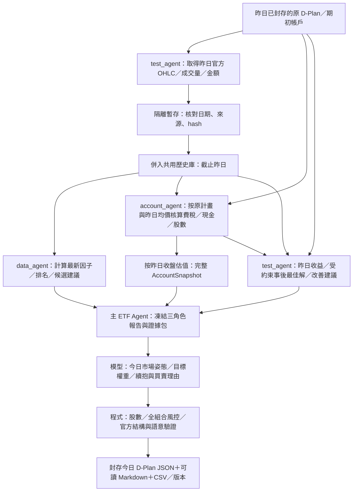

# 每日 Agent 分工與串接計畫

更新：2026-10-11。三個角色已各自整理為資料夾，下載已歸 test_agent、估值已歸 account_agent，D-Plan 編譯會同時產生 JSON／Markdown。**下圖的每日增量、跨日帳務與回饋串接尚待實作**；目前可執行的歷史展示與命令見 [決策流程](decision_workflow.md)。

## 一天如何執行

「昨天」指上一個交易日。以 2025-10-02 的決策為例，可使用截至 10/1 的行情、10/1 原計畫的模擬成交及檢討，當日 10/2 行情保持不可讀。10/1 的事後結果不回改已封存的 10/1 決策。

取得行情必須先核對昨日計畫已封存，再確認下載日期早於今天決策日。隔離區是取得資料後的檢查入口；通過檢查的昨日行情才可供下一日使用。歷史原始來源與當日資料版本保留，不能修改昨天的證據包。

## 責任與交付

| 角色 | 工作 | 交付主 Agent 的內容 |
|---|---|---|
| test_agent | 下載及整理上一交易日的開、高、低、收、量、成交金額，併入歷史；比較原計畫、不交易與受約束事後配置。 | 行情版本、昨日收益、最佳化狀態、具體改善建議及其日期／證據。 |
| data_agent | 僅讀截止日以前的歷史，計算指標、因子與排名。 | 最新因子、候選排序、數值建議、缺件／限制與來源。 |
| account_agent | 依昨日真正採用的原計畫核算模擬成交、費稅、現金與完整股數，並按收盤估值。 | 完整 AccountSnapshot、現金／可用資金、逐股股數／市值、NAV與帳務問題。 |
| 主 ETF Agent | 整合三份報告，提出今日權重與理由；程式完成股數、風控及編譯。 | 官方 D-Plan JSON、可讀 Markdown、檢查 CSV與manifest。 |

成交／現金使用昨日官方成交金額÷成交股數得到的日均價；持股市值與 NAV 使用昨日收盤。開收盤價本身不足以計算精確均價，所以下載也要保留成交量與金額。費率依 [F07 §⑥](../specs/official/07_D-Plan_guide_v4.2.md)，模擬公式與精度限制見 [評估說明](evaluation.md)。

帳戶只能承接**原先採用的 D-Plan**，不能承接事後最佳組合。最佳解已知道昨日結果，只能說明列明限制下的事後可達配置；改善建議須標示事後性質，不自動改因子權重或風控門檻。

各角色仍是同一 Python 專案內的函式與報告介面；目前只有主 ETF Agent 呼叫投資決策模型。[實際程式逐檔位置](source_map.md#核心流程模組)

## 資料與帳戶如何共用

首版建議使用單一本機 SQLite 歷史庫，利用 Python 內建 sqlite3，不新增依賴。行情按日期／股票／市場索引，保存原始來源hash、取得時間、量值與缺值狀態；另外保留 JSON／CSV與原始回應，供人工檢查。SQLite 與每日增量合約需在下一批確認後建立，目前仍使用明確指定的 CSV／JSON run。

每次主決策取得固定的截止日與資料版本，三份報告引用相同歷史版本與帳戶版本。test_agent 才能寫入行情；data_agent 與決策模型只讀。account_agent 產生新的模擬帳戶版本，不覆寫期初快照，也不接受模型直接改帳。

每日串接必須處理下列情境：

- 同日行情重跑不重複合併；同一 plan hash 不重複入帳。
- 當日未成交或均價缺失的委託保留為未成交，原持股不消失；持股缺收盤時完整 NAV 為未知。
- 日期錯誤、缺來源hash、帳戶與昨日計畫不一致時阻擋下一日決策。
- 初日沒有可用的前日計畫時明示缺件；不產生假的績效或改善建議。
- 未核對官方庫存／交割的結果維持 simulated／demo，正式可用額度未知。[帳戶合約](account.md)

## D-Plan Markdown 怎麼閱讀

`compile-plan`／`decide-plan` 的新 compiled run 自動保存與計畫同名的 `.md`；候選保存 `dplan_candidate.md`。內容包括日期與驗證狀態、市場姿態與現金理由、前收財務估算、原股數→目標股數、買賣委託、模型原始理由與反方證據、官方引用及資料問題。JSON仍保留精確數值與官方格式，Markdown不再呼叫模型或重算股數。

Markdown 與 CSV 一起納入 manifest 的hash，workspace 用 `files.plan_markdown` 指向說明檔。原本的 `decision.md` 是模型提示，兩者用途不同。舊封存 run 不自動回寫；可另產生明示的閱讀副本。[產物導覽](artifacts.md#計畫編譯股數驗證與封存)

## 下一批的順序與驗收

| 批次 | 輸入 → 輸出 | 必要驗收 |
|---|---|---|
| 已完成：角色資料夾與 Markdown | 既有 9/30 分析／帳戶 → 同內容的決策包；原計畫 → 可讀說明。 | 角色責任分離、CLI可匯入、股數與輸入數值不變、舊封存hash不變、Markdown hash與JSON一致。 |
| 建議下一批：歷史庫與原計畫模擬入帳 | 明確指定的既有 10/1 隔離行情＋10/1 原計畫 → 截至10/1歷史與新模擬帳戶。 | 全程離線；正常／重跑無重複／日期不符／缺成交保股／缺估價NAV未知。 |
| 後續：檢討與下一日固定輸入 | 截至10/1行情與模擬帳戶 → 10/2因子／回顧／證據包。 | 三報告引用同版；只允許截至10/1資料；最佳解不替代原帳；缺件誠實阻擋。 |
| 後續：新決策與完整每日入口 | 凍結10/2證據包 → 新模型草稿／D-Plan JSON／Markdown。 | 模型呼叫另依明確授權；最終股數由程式計算，驗證通過再封存。 |

目前單日解析器尚未輸出 open／high／low、跨月份價格視窗尚未串接，`review_previous_day` 仍只接受首日缺件狀態。上述批次會補齊這些介面，不能用現有 10/1隔離結果直接冒充已完成每日循環。[完成證據與待辦](../checklist.md)
